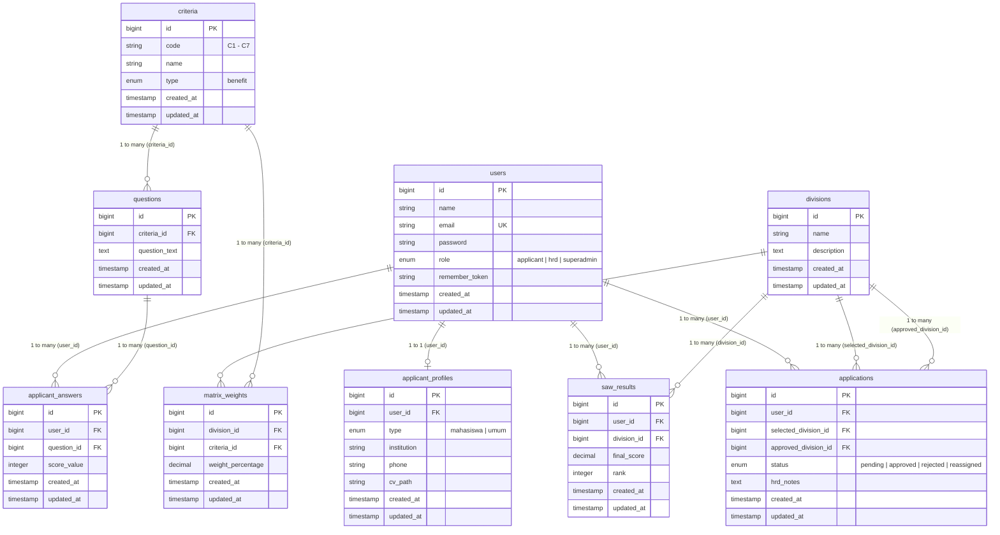

# Product Requirements Document (PRD)
**Sistem Pendukung Keputusan (SPK) Rekomendasi Penempatan Divisi Magang**  
**Studi Kasus:** PT Vinix Seven Aurum (VINIX7)

---

## 1. Pendahuluan

### 1.1 Latar Belakang
PT Vinix Seven Aurum menyediakan 14 pilihan divisi magang spesifik di bidang Teknologi Informasi dan Bisnis pada Program Magang & Studi Independen. Banyak pelamar (baik mahasiswa maupun umum) menghadapi dilema dan ketidakpastian dalam menentukan divisi yang paling relevan dengan minat dan kemampuan teknis mereka. 

Untuk mengatasi kendala ini, dibangun Sistem Pendukung Keputusan (SPK) berbasis *web* yang berfungsi sebagai **"Kompas Karir"**. Sistem ini memandu pelamar melewati serangkaian asesmen kompetensi terukur untuk menghasilkan rekomendasi divisi berbasis data sebelum mengirimkan berkas lamaran resmi kepada HRD.

### 1.2 Tujuan
1. Mengotomatisasi pemetaan kompetensi pelamar ke dalam 14 divisi menggunakan algoritma **Simple Additive Weighting (SAW)**.
2. Memfasilitasi HRD dalam meninjau data analitik pelamar dan mengeksekusi keputusan rekrutmen secara transparan.
3. Memberikan pengalaman portal mandiri bagi pelamar untuk memantau status lamaran secara *real-time*.
4. Mengimplementasikan infrastruktur cloud modern (*Serverless Database*, *Cloud Document Storage*, dan *Serverless Deployment*) yang skalabel dan efisien.

---

## 2. Pedoman Desain & UI/UX (Identitas vinix7.id)

Antarmuka aplikasi mengadopsi standar identitas visual *enterprise* dari situs resmi perusahaan [vinix7.id](https://vinix7.id/):
*   **Warna Utama (*Primary - Navy*):** **`#1e3a8a`** (`blue-900` / `blue-800`). Mewakili kepercayaan (*trust*), kestabilan, dan profesionalisme teknologi informasi. Digunakan pada sidebar, card header, lencana divisi, dan tombol utama (*action button*).
*   **Warna Aksen (*Secondary - Aurum*):** **`#eab308`** (`yellow-500` / `amber-500`). Merujuk pada nama "Aurum" dan visi "Indonesia Emas". Digunakan khusus untuk menonjolkan Top 3 Rekomendasi SAW, badge status, dan elemen *Call to Action* (CTA).
*   **Navigasi & Header (*Executive Clean White*):** Mengusung latar belakang putih eksekutif (`bg-white/95 backdrop-blur border-b border-slate-200/90 shadow-xs`) berpadu dengan logo resmi VINIX7 berwarna asli (Royal Blue `#003399` dan Aurum Yellow `#fbe156`) tanpa teks samping yang padat, menciptakan tampilan korporat yang modern, elegan, dan fokus. Logo disematkan dalam format *Base64 Data URI* dengan keandalan tinggi bebas risiko *broken asset* pada lingkungan *serverless* / Vercel.
*   **Warna Latar (*Background*):** **`#f8fafc`** (`slate-50`). Memberikan kesan bersih, luas, dan nyaman di mata saat membaca instrumen kuesioner.
*   **Tipografi:** Font Sans-Serif modern (**Inter**).
*   **Mikro-Interaksi & Feedback:**
    *   *Password Visibility Toggle:* Ikon mata interaktif untuk melihat/menyembunyikan kata sandi pada halaman login dan registrasi.
    *   *SweetAlert2:* Modal dialog profesional untuk konfirmasi pengiriman lamaran, penghapusan data master, eksekusi keputusan HRD, konfirmasi logout, dan notifikasi kegagalan autentikasi (*Autentikasi Gagal*).

---

## 3. Alur Pengguna (User Journey)

### 3.1 Aktor: Pelamar (Mahasiswa / Umum)
1.  **Registrasi & Login (Wajib):** Mendaftarkan akun dengan nama, email, dan kata sandi yang aman.
2.  **Lengkapi Biodata:** Mengisi profil dengan kategori pelamar (Mahasiswa atau Umum), nama perguruan tinggi/instansi asal, dan nomor WhatsApp aktif. Formulir menyediakan petunjuk dinamis sesuai kategori yang dipilih.
3.  **Self-Assessment (Kuesioner Livewire):** Menjawab 18 pertanyaan kompetensi (mencakup kriteria C1–C7) dengan skala nilai bertingkat (20–100) melalui formulir multi-langkah (*multi-step*) tanpa *reload* halaman.
4.  **Hasil Analisis SAW:** Sistem menampilkan **Top 3 Divisi Rekomendasi** dengan persentase kecocokan tertinggi berbalut aksen emas (*Aurum*).
5.  **Finalisasi Lamaran & Unggah CV:** Pelamar memilih salah satu dari divisi yang direkomendasikan, mengunggah dokumen CV dalam format PDF (otomatis disimpan ke **Cloudinary**), lalu mengirimkan lamaran.
6.  **Pemantauan Status:** Pelamar dapat login kembali sewaktu-waktu untuk melihat status berkas (Pending, Diterima, Ditolak, atau Dialihkan).

### 3.2 Aktor: Admin HRD
1.  **Dashboard Analitik:** Memantau rekapitulasi data pelamar, distribusi divisi yang diminati, serta rasio pelamar Mahasiswa vs Umum.
2.  **Review Detail Pelamar:** Meninjau lembar jawaban mentah 18 kuesioner, hasil komputasi SAW, serta mengakses berkas CV pelamar langsung melalui tautan Cloudinary HTTPS.
3.  **Approval System (Eksekusi Keputusan):**
    *   *Approve:* Menerima pelamar pada divisi pilihannya.
    *   *Reassign:* Mengalihkan penerimaan pelamar ke rekomendasi peringkat ke-2 atau ke-3 berdasarkan evaluasi HRD atau kuota divisi.
    *   *Reject:* Menolak lamaran.

### 3.3 Aktor: Super Admin
1.  **Manajemen Master Data:** Mengelola 14 Data Divisi, 7 Kriteria Inti, dan 18 Pertanyaan Kuesioner.
2.  **Manajemen Bobot (W):** Mengatur persentase matriks pembobotan algoritma SAW (14 divisi x 7 kriteria = 98 relasi bobot) secara dinamis tanpa perlu mengubah kode sumber aplikasi.

---

## 4. Logika Sistem Algoritma SAW

1.  **Alternatif ($A_i$):** 14 Divisi Magang:
    1. Human Resource (SDM) Analyst
    2. Python Data Science Engineer
    3. Data Analyst
    4. Python Machine Learning & AI Engineer
    5. Web & UIUX Developer
    6. Social Media & Digital Marketing Strategist
    7. Tech Project Management Specialist
    8. Digital Public Relations & Communication Specialist
    9. Ethical Hacker
    10. Bisnis Digital Analyst
    11. Cybersecurity Engineer
    12. Investment & Financial Market Analyst
    13. Business Administration Intelligence Analyst (Power BI & Excel)
    14. Cybercrime & Forensic Investigator

2.  **Kriteria ($C_j$):**
    *   $C_1$: Web, Frontend & UI/UX Design
    *   $C_2$: Artificial Intelligence, Machine Learning & Python Programming
    *   $C_3$: Data Analytics, Business Intelligence & SQL
    *   $C_4$: Cyber Security, Ethical Hacking & Digital Forensics
    *   $C_5$: IT Project Management & Software Architecture
    *   $C_6$: Digital Marketing, Public Relations & Human Resources
    *   $C_7$: Financial Modeling & Market Investment Analysis

3.  **Sifat Kriteria:** Seluruh kriteria bertipe **Benefit** (semakin tinggi skor asesmen pelamar, semakin tinggi kesesuaian nilai).

4.  **Tahapan Komputasi:**
    *   Membentuk Matriks Keputusan $X$ dari akumulasi jawaban pelamar per kriteria.
    *   Normalisasi Matriks $R$:
        $$r_{ij} = \frac{x_{ij}}{\max_i(x_{ij})}$$
    *   Perkalian Matriks Terbobot:
        $$V_i = \sum_{j=1}^{n} w_j \cdot r_{ij}$$
    *   Perangkingan nilai preferensi $V_i$ secara *descending* untuk menentukan 3 divisi peringkat teratas (*Top 3*).

---

## 5. Struktur Database & Model Data

Aplikasi menggunakan arsitektur basis data relasional **TiDB Cloud (Serverless MySQL)** dengan koneksi TLS/SSL (`storage/tidb-ca.pem`) pada port 4000. 

### 5.1 Diagram Relasi Entitas (Entity Relationship Diagram - ERD)



### 5.2 Rincian 9 Entitas Utama

1.  **`users`**: Entitas autentikasi utama. Menyimpan data kredensial dan peran RBAC (`applicant`, `hrd`, `superadmin`).
2.  **`applicant_profiles`**: Profil demografi pelamar berelasi 1:1 dengan `users`. Menyimpan kategori (`mahasiswa` / `umum`), instansi/kampus, nomor WhatsApp, dan *path* berkas CV. Dilengkapi accessor `cv_url` untuk tautan HTTPS Cloudinary.
3.  **`divisions`**: Entitas master 14 divisi magang spesifik PT Vinix Seven Aurum sebagai himpunan alternatif ($A_1 - A_{14}$).
4.  **`criteria`**: Entitas 7 kriteria asesmen inti ($C_1 - C_7$) berkarakter *Benefit*.
5.  **`questions`**: Entitas 18 instrumen kuesioner asesmen mandiri pelamar yang terhubung langsung ke kriteria induknya.
6.  **`matrix_weights`**: Matriks preferensi pembobotan ($W$) yang menghubungkan 14 Divisi x 7 Kriteria (98 pasangan bobot) yang dapat dikonfigurasi dinamis oleh Super Admin.
7.  **`applicant_answers`**: Lembar rekaman jawaban mentah skala Likert/numerik (20–100) per butir pertanyaan kuesioner dari pelamar.
8.  **`saw_results`**: Hasil kalkulasi mesin SAW berupa skor preferensi akhir ($V_i$) dan peringkat (*rank*) per divisi untuk tiap pelamar.
9.  **`applications`**: Berkas pengajuan lamaran final pelamar yang memuat divisi pilihan, status persetujuan HRD (`pending`, `approved`, `rejected`, `reassigned`), divisi final yang disetujui, serta catatan evaluasi HRD.

---

## 6. Infrastruktur & Cloud Architecture

```
                  ┌───────────────────────────────┐
                  │        Pengguna / Web         │
                  └───────────────┬───────────────┘
                                  │ HTTPS
                                  ▼
      ┌────────────────────────────────────────────────────────┐
      │                   Aplikasi Laravel 12                  │
      │        (Vercel Serverless / Docker Container)          │
      └──────────────┬─────────────────────────┬───────────────┘
                     │ TLS/SSL (Port 4000)     │ HTTPS REST API
                     ▼                         ▼
         ┌───────────────────────┐ ┌───────────────────────┐
         │      TiDB Cloud       │ │       Cloudinary      │
         │  (Serverless MySQL)   │ │ (Media & Document CV) │
         └───────────────────────┘ └───────────────────────┘
```

1.  **Database Layer:** **TiDB Cloud (Serverless MySQL)** pada AWS Region `ap-southeast-1` (Singapore) dengan verifikasi sertifikat SSL CA (`storage/tidb-ca.pem`).
2.  **Storage Layer:** **Cloudinary Cloud Storage** dengan penataan folder terisolasi (`spk-magang-vinix7/cvs`) untuk menjaga pemisahan berkas antar proyek.
3.  **Deployment Layer:**
    *   **Vercel:** Menggunakan serverless PHP runtime (`vercel-php`) dengan konfigurasi `vercel.json` dan routing `/tmp`.
    *   **Docker:** Menggunakan `Dockerfile` multi-stage berbasis Nginx + PHP-FPM untuk platform container (Render / Railway / VPS).

---

## 7. Penjaminan Kualitas (Quality Assurance)

Sistem telah diuji secara otomatis melalui **PHPUnit Test Suite**:
*   **Total Pengujian:** 35 Tests
*   **Total Assertions:** 95 Assertions
*   **Status:** **100% Passed**
*   **Cakupan Uji:** Autentikasi, otorisasi peran (RBAC), integritas kalkulasi algoritma SAW, penanganan berkas Cloudinary, dan stabilitas seeding master data.