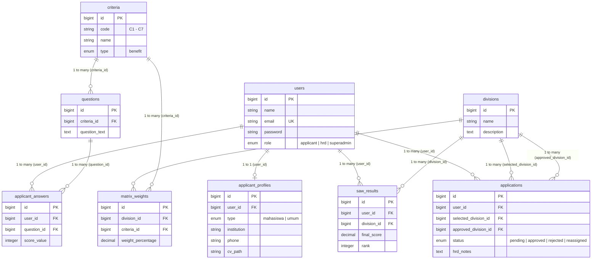

# SPK Penempatan Divisi Magang - PT Vinix Seven Aurum

Sistem Pendukung Keputusan (SPK) berbasis *web* yang berfungsi sebagai "Kompas Karir" bagi pelamar magang di PT Vinix Seven Aurum. Sistem ini memetakan kompetensi pelamar ke dalam 14 divisi spesifik menggunakan algoritma **Simple Additive Weighting (SAW)**.

Antarmuka aplikasi ini didesain secara khusus mengikuti identitas visual (UI/UX) *enterprise* dari website resmi [vinix7.id](https://vinix7.id/), mengusung *Executive Clean White Navbar* dengan logo resmi VINIX7 (*Royal Blue* & *Aurum Gold*) yang disematkan secara tangguh menggunakan *Base64 Data URI* untuk keandalan maksimal tanpa risiko aset gambar rusak (*broken image*).

---

## 🚀 Fitur Utama

*   **Mandatory Authentication & Keamanan Akun:**
    *   Portal mandiri dengan registrasi dan login wajib bagi pelamar untuk melacak status lamaran.
    *   Fitur *Password Visibility Toggle* (Tampilkan / Sembunyikan Kata Sandi) dengan ikon responsif.
    *   Modal notifikasi interaktif **SweetAlert2** untuk kegagalan autentikasi (*Autentikasi Gagal*) dan konfirmasi logout.
*   **Interactive Multi-step Assessment (Livewire):**
    *   18 instrumen pertanyaan *self-assessment* (mewakili kriteria C1–C7) dengan transisi mulus tanpa memuat ulang halaman (*no-reload*).
    *   Formulir dinamis yang menyesuaikan petunjuk pengisian bagi pelamar kategori **Mahasiswa** maupun **Umum**.
*   **Real-time SAW Engine:**
    *   Perhitungan matriks algoritma SAW memproses input kuesioner pelamar terhadap 98 bobot divisi secara instan.
    *   Menampilkan **Top 3 Rekomendasi Divisi** dengan persentase kecocokan tertinggi berbalut aksen emas (*Aurum*).
*   **Cloud Document Management (Cloudinary):**
    *   Pengunggahan berkas CV (PDF) terintegrasi langsung dengan **Cloudinary Cloud Storage** pada folder terisolasi (`spk-magang-vinix7/cvs`).
    *   Akses dokumen CV dapat dibuka langsung melalui tautan aman HTTPS dari dashboard pelamar maupun HRD.
*   **HRD Analytical Dashboard:**
    *   Panel manajemen komprehensif bagi HRD untuk melihat rekapitulasi pelamar, skor mentah asesmen, dan persentase SAW.
    *   Sistem eksekusi keputusan rekrutmen (*Terima*, *Alihkan ke Rekomendasi 2/3*, atau *Tolak*) dengan konfirmasi SweetAlert2.
*   **Super Admin Dynamic Matrix Weights:**
    *   Manajemen master data 14 Divisi, 7 Kriteria Inti, dan 18 Pertanyaan Kuesioner.
    *   Kemampuan mengubah atau menghapus bobot matriks (*14 x 7 = 98 bobot*) secara fleksibel tanpa mengubah kode sumber.

---

## 👥 14 Pilihan Divisi Magang

1. Human Resource (SDM) Analyst
2. Python Data Science Engineer
3. Data Analyst
4. Python Machine Learning & AI Engineer
5. Web & UIUX Developer
6. Social Media & Digital Marketing Strategist
7. Tech Project Management Specialist
8. Digital Public Relations & Communication Specialist
9. Ethical Hacker
10. Bisnis Digital Analyst
11. Cybersecurity Engineer
12. Investment & Financial Market Analyst
13. Business Administration Intelligence Analyst (Power BI & Excel)
14. Cybercrime & Forensic Investigator

---

## 🛠️ Arsitektur & Tech Stack

*   **Backend Framework:** Laravel 12 (PHP 8.2+)
*   **Dynamic Component:** Livewire
*   **Frontend Framework:** Tailwind CSS 3 (Kustomisasi Enterprise Vinix7) & Vite
*   **Interactive Alerts:** SweetAlert2
*   **Database:** **TiDB Cloud (Serverless MySQL)** terenkripsi TLS/SSL
*   **Cloud Storage:** **Cloudinary** (Media & Document Storage)
*   **Deployment Ready:** 
    *   **Vercel Serverless:** Dikonfigurasi dengan `vercel.json` dan `api/index.php`.
    *   **Docker Container:** Dikonfigurasi dengan `Dockerfile` berbasis Nginx + PHP-FPM untuk platform container (Render / Railway / VPS).

---

## 🗄️ Relasi Database & ERD (Entity Relationship Diagram)

Basis data menggunakan arsitektur relasional **TiDB Cloud (Serverless MySQL)** yang terdiri dari 9 entitas utama:



### Ringkasan Entitas & Relasi Data:
1. **`users`**: Tabel otentikasi akun & peran pengguna (`applicant`, `hrd`, `superadmin`).
2. **`applicant_profiles`**: Profil biodata pelamar (*One-to-One* ke `users`) dan tautan dokumen CV Cloudinary.
3. **`divisions`**: Master 14 divisi magang (Himpunan Alternatif SAW $A_1 - A_{14}$).
4. **`criteria`**: Master 7 kriteria asesmen inti kompetensi ($C_1 - C_7$).
5. **`questions`**: 18 butir instrumen kuesioner asesmen mandiri pelamar.
6. **`matrix_weights`**: Matriks 98 bobot relasi (14 Divisi × 7 Kriteria) untuk kalkulasi SAW.
7. **`applicant_answers`**: Rekaman skor jawaban kuesioner pelamar (skala 20–100).
8. **`saw_results`**: Hasil kalkulasi skor preferensi $V_i$ dan perangkingan 14 divisi per pelamar.
9. **`applications`**: Berkas pengajuan lamaran resmi pelamar dan riwayat persetujuan HRD.

---

## 🔌 Panduan Koneksi Database GUI (DBeaver / TablePlus / Navicat)

Untuk mengelola atau menginspeksi basis data TiDB Cloud menggunakan GUI DBeaver:

1. **Driver:** Pilih **MySQL** (atau **MariaDB**).
2. **Main Settings:**
   * **Host:** Host cluster TiDB Cloud Anda (port default: `4000`)
   * **Port:** `4000`
   * **Database:** `spk_magang_vinix7`
   * **Username:** Sesuai kredensial `.env`
   * **Password:** Sesuai kredensial `.env`
3. **SSL Settings:**
   * Centang opsi **Use SSL**
   * **SSL Mode:** `VERIFY_CA` (atau centang *Trust server certificate*)
   * **CA Certificate:** Arahkan ke file sertifikat CA: `storage/tidb-ca.pem`
4. **Tips Diagram ERD Bersih di DBeaver:**
   * Klik kanan pada database > pilih **View Diagram**.
   * Bersihkan tabel sistem bawaan TiDB dengan `Ctrl + A` lalu `Delete` (hanya menghapus dari canvas, bukan dari database).
   * Tarik (*drag-and-drop*) 9 tabel inti SPK dari navigator untuk memperoleh ERD yang rapi.

---

## 🎨 Panduan Tema (Tailwind Colors)

Sistem ini menggunakan palet warna khusus sesuai identitas resmi:
```javascript
theme: {
    extend: {
        colors: {
            'vinix-navy': '#1e3a8a',  // Kepercayaan & Profesionalisme IT
            'vinix-aurum': '#eab308', // Emas Inovasi & Rekomendasi Unggulan
            'vinix-bg': '#f8fafc',    // Latar Bersih Slate 50
        },
        fontFamily: {
            sans: ['Inter', 'sans-serif'],
        }
    }
}
```

---

## ⚙️ Panduan Instalasi Lokal (Development)

1. Clone repositori:
   ```bash
   git clone https://github.com/HaffiantResditya/spk-magang-vinix7.git
   cd spk-magang-vinix7
   ```
2. Pasang dependensi PHP & Node:
   ```bash
   composer install
   npm install && npm run build
   ```
3. Salin dan sesuaikan konfigurasi environment:
   ```bash
   cp .env.example .env
   php artisan key:generate
   ```
4. Konfigurasikan kredensial database (TiDB Cloud atau MySQL lokal) dan Cloudinary pada file `.env`.
5. Jalankan migrasi dan seeder awal:
   ```bash
   php artisan migrate --seed
   ```
6. Jalankan dev server lokal:
   ```bash
   php artisan serve
   npm run dev
   ```

---

## 👥 Akun Bawaan (Default Seeder)

Setelah menjalankan `php artisan migrate --seed`, Anda dapat login menggunakan kredensial berikut:

| Peran (Role) | Alamat Email | Kata Sandi |
| :--- | :--- | :--- |
| **Super Admin** | `superadmin.vinix7@gmail.com` | `password` |
| **Admin HRD** | `hrd.vinix7@gmail.com` | `password` |
| **Pelamar Demo** | `pelamar.vinix7@gmail.com` | `password` |

*(Pelamar baru juga dapat mendaftarkan akun mandiri melalui menu Registrasi).*

---

## 🧪 Pengujian Otomatis (Automated Tests)

Aplikasi dilengkapi dengan rangkaian pengujian unit dan fitur komprehensif (**35 Tests, 95 Assertions**):
```bash
php artisan test
```
Pengujian mencakup:
*   Autentikasi & Validasi Kata Sandi
*   Role-Based Access Control (RBAC)
*   Kalkulasi Algoritma SAW & Penentuan Top 3
*   Penyimpanan Dokumen Cloudinary & URL Accessor
*   Integritas Data Master Divisi, Kriteria, dan Bobot